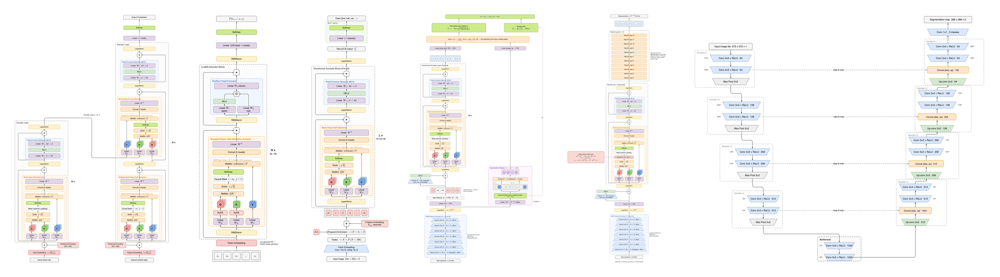

# drawio-DL-templates

A collection of fully expanded, contemporary deep learning architecture templates for Draw.io — from Transformers and LLMs to vision, diffusion, state-space and self-supervised speech models. Every model is drawn down to its real operations instead of black boxes, so you can import, edit and publish without drawing complex structures from scratch.

## Features
- **Easy to Import**: Every library is a standard Draw.io `mxlibrary` file — open it and drag templates onto the canvas.
- **No Black Boxes**: Complete architectures are drawn down to their actual operations; every attention block is expanded to Linear $W_Q/W_K/W_V$ → **Q, K, V squares** → $QK^\top$ → $\div\sqrt{d_k}$ → (Bias / Mask) → Softmax → $\cdot V$ → Concat → $W^O$.
- **Consistent Visual Language**: CNN operations (Conv, Pooling, Up-conv, Patchify, Conv1d) are trapezoids; everything else is a (rounded) rectangle or square, with one color per operation type.
- **LaTeX Math**: Formulas such as $\mathrm{softmax}(QK^\top/\sqrt{d_k})V$, $x\cdot(1+\gamma)+\beta$ or $h_t=\bar{A}h_{t-1}+\bar{B}x_t$ are typeset by Draw.io's built-in MathJax.
- **Training vs. Inference**: Models whose structure differs between the two (BERT, wav2vec 2.0, HuBERT, WavLM) ship both a **Pre-training** and an **Inference** template; unchanged Transformer layers are drawn as a compact stack in the inference view.
- **Layered Organization**: Templates go from basic units to reusable modules to complete models, with **one library file per model**.
- **PNG Previews**: Every template comes with a 2× PNG preview under `png/`.

## Template Library

Templates are organized into three levels — from basic building blocks to complete model architectures:

### DL Basic — Basic Units
Minimal, reusable building blocks: trapezoid CNN layers, Linear / Norm / Activation, attention operations, and Q / K / V squares.

### DL Module — Reusable Modules
Common sub-structures composed of basic units — attention variants, feed-forward networks, Transformer layers and residual blocks — reusable across different models.

### Complete Models — one file per model

| Domain | Libraries |
|--------|-----------|
| **Transformer / LLM** | `Transformer.xml`, `BERT.xml`, `GPT-2.xml`, `LLaMA.xml`, `MoE-Mixtral.xml` |
| **Vision** | `ViT.xml`, `Swin-Transformer.xml`, `ResNet-50.xml`, `U-Net.xml` |
| **Multimodal / Generative** | `CLIP.xml`, `DiT.xml` |
| **State Space** | `Mamba.xml` |
| **Self-supervised Speech** | `wav2vec2.xml`, `HuBERT.xml`, `WavLM.xml` |

## Template Catalog

### 📦 library/DL_Basic.xml
| Template | Description | Preview |
|----------|-------------|---------|
| Conv (trapezoid ▽) | Convolution layer, wide → narrow along a downward flow | [png](png/basic/01-conv-trapezoid-down.png) |
| Conv (trapezoid △) | Convolution layer, wide → narrow along an upward flow | [png](png/basic/02-conv-trapezoid-up.png) |
| Pooling (trapezoid) | Max / average pooling | [png](png/basic/03-pooling-trapezoid.png) |
| Up-conv / ConvTranspose (trapezoid) | Transposed convolution for upsampling | [png](png/basic/04-up-conv-convtranspose-trapezoid.png) |
| Conv1d (trapezoid) | 1-D convolution (audio / sequence) | [png](png/basic/05-conv1d-trapezoid.png) |
| Linear | Fully connected projection | [png](png/basic/06-linear.png) |
| LayerNorm | Layer normalization | [png](png/basic/07-layernorm.png) |
| RMSNorm | Root-mean-square normalization | [png](png/basic/08-rmsnorm.png) |
| BatchNorm | BatchNorm → ReLU | [png](png/basic/09-batchnorm.png) |
| Activation | GELU / ReLU / SiLU | [png](png/basic/10-activation.png) |
| Softmax | Softmax | [png](png/basic/11-softmax.png) |
| MatMul | Matrix multiplication $QK^\top$ | [png](png/basic/12-matmul.png) |
| Scale | Scaling $\div\sqrt{d_k}$ | [png](png/basic/13-scale.png) |
| Mask | Causal / padding mask | [png](png/basic/14-mask.png) |
| Add (+) | Residual addition | [png](png/basic/15-add.png) |
| Multiply (⊙) | Element-wise product (gating) | [png](png/basic/16-multiply.png) |
| Concat | Concatenation | [png](png/basic/17-concat.png) |
| Q / K / V | Query, key and value squares | [png](png/basic/18-q.png) · [png](png/basic/19-k.png) · [png](png/basic/20-v.png) |
| Q / K / V (multi-head stack) | Stacked squares representing $h$ heads | [png](png/basic/21-q-k-v-multi-head-stack.png) |
| Embedding | Token embedding | [png](png/basic/22-embedding.png) |
| Positional Encoding | Sinusoidal / learned positional encoding | [png](png/basic/23-positional-encoding.png) |
| Token Sequence | Row of token squares $x_1 \dots x_n$ | [png](png/basic/24-token-sequence.png) |
| Input / Output | Input / output node | [png](png/basic/25-input-output.png) |
| Container (dashed) | Dashed group frame for blocks | [png](png/basic/26-container-dashed.png) |

### 📦 library/DL_Module.xml
| Template | Description | Preview |
|----------|-------------|---------|
| Scaled Dot-Product Attention | Q, K, V → $QK^\top$ → scale → mask → softmax → $\cdot V$ | [png](png/module/01-scaled-dot-product-attention.png) |
| Multi-Head Self-Attention | Projections, per-head SDPA, Concat, $W^O$ | [png](png/module/02-multi-head-self-attention.png) |
| Masked (Causal) Multi-Head Self-Attention | MHSA with causal mask | [png](png/module/03-masked-causal-multi-head-self-attention.png) |
| Grouped-Query Attention + RoPE | $h$ query heads, $g$ KV groups, rotary embeddings on Q and K | [png](png/module/04-grouped-query-attention-rope.png) |
| Window Attention (Swin W-MSA) | MHSA with relative position bias | [png](png/module/05-window-attention-swin-w-msa.png) |
| Multi-Head Cross-Attention | Q from the decoder, K / V from encoder memory | [png](png/module/06-multi-head-cross-attention.png) |
| Feed-Forward Network (MLP) | Linear → activation → Linear | [png](png/module/07-feed-forward-network-mlp.png) |
| SwiGLU Feed-Forward | Gated FFN: $W_2(\mathrm{SiLU}(W_1x)\odot W_3x)$ | [png](png/module/08-swiglu-feed-forward.png) |
| Transformer Encoder Layer (Post-LN) | MHSA → Add & Norm → FFN → Add & Norm | [png](png/module/09-transformer-encoder-layer-post-ln.png) |
| Transformer Decoder Layer (Post-LN) | Masked MHSA → Cross-Attention → FFN | [png](png/module/10-transformer-decoder-layer-post-ln.png) |
| Transformer Block (Pre-LN, GPT/ViT) | Norm → MHSA → Add; Norm → FFN → Add | [png](png/module/11-transformer-block-pre-ln-gpt-vit.png) |
| LLaMA Decoder Block | RMSNorm, GQA + RoPE, SwiGLU | [png](png/module/12-llama-decoder-block.png) |
| ResNet Bottleneck Block | 1×1 → 3×3 → 1×1 with identity shortcut | [png](png/module/13-resnet-bottleneck-block.png) |
| ResNet Bottleneck Block (projection) | Bottleneck with strided 1×1 projection shortcut | [png](png/module/14-resnet-bottleneck-block-projection.png) |
| ResNet Basic Block | Two 3×3 convolutions (ResNet-18/34) | [png](png/module/15-resnet-basic-block.png) |
| CNN Feature Encoder (wav2vec 2.0 / HuBERT) | 7 × Conv1d, 25 ms receptive field, 20 ms hop | [png](png/module/16-cnn-feature-encoder-wav2vec-2-0-hubert.png) |
| Gumbel Product Quantizer (wav2vec 2.0) | Gumbel-Softmax over $G=2$ codebooks of $V=320$ entries | [png](png/module/17-gumbel-product-quantizer-wav2vec-2-0.png) |

### 📦 library/models/*.xml
| Library | Template | Description | Preview |
|---------|----------|-------------|---------|
| `Transformer.xml` | Transformer (Vaswani et al., 2017) | Encoder–decoder with sinusoidal PE, self- / cross-attention | [png](png/models/Transformer.png) |
| `BERT.xml` | BERT — Pre-training (MLM + NSP) | Token / segment / position embeddings, Post-LN encoder, MLM and NSP heads | [png](png/models/BERT-pre-training.png) |
| | BERT — Inference | Embeddings → 12 stacked encoder layers → contextual embeddings | [png](png/models/BERT-inference.png) |
| `GPT-2.xml` | GPT-2 (decoder-only) | Pre-LN causal decoder, weight-tied LM head | [png](png/models/GPT-2.png) |
| `LLaMA.xml` | LLaMA (decoder-only) | RMSNorm, grouped-query attention with RoPE, SwiGLU | [png](png/models/LLaMA.png) |
| `MoE-Mixtral.xml` | Sparse MoE FFN (Mixtral-style) | Router → top-2 gating over 8 SwiGLU experts → weighted sum | [png](png/models/MoE-Mixtral.png) |
| `ViT.xml` | Vision Transformer (ViT) | Patch-embedding conv, [CLS] token, learned position embedding, MLP head | [png](png/models/ViT.png) |
| `Swin-Transformer.xml` | Swin Transformer (two successive blocks) | W-MSA / SW-MSA with cyclic shift and relative position bias, plus stage pipeline | [png](png/models/Swin-Transformer.png) |
| `ResNet-50.xml` | ResNet-50 | Stem, conv2_x – conv5_x bottleneck stages, global pooling, FC | [png](png/models/ResNet-50.png) |
| `U-Net.xml` | U-Net (Ronneberger et al., 2015) | Contracting / expansive paths with copy-and-crop skip connections | [png](png/models/U-Net.png) |
| `CLIP.xml` | CLIP (contrastive image–text) | ViT image encoder, causal text encoder, $I\cdot T^\top$ similarity matrix | [png](png/models/CLIP.png) |
| `DiT.xml` | Diffusion Transformer (DiT, adaLN-Zero) | Patchify, adaLN-Zero modulation $(\gamma, \beta, \alpha)$ from timestep and class conditioning | [png](png/models/DiT.png) |
| `Mamba.xml` | Mamba (selective state space) | Conv1d, selective SSM with input-dependent $\Delta, B, C$, gated output | [png](png/models/Mamba.png) |
| `wav2vec2.xml` | wav2vec 2.0 (Base) — Pre-training | CNN encoder, span masking, Transformer, Gumbel quantizer, contrastive + diversity loss | [png](png/models/wav2vec2-pre-training.png) |
| | wav2vec 2.0 (Base) — Inference | CNN encoder → conv positional embedding → 12 stacked Transformer layers | [png](png/models/wav2vec2-inference.png) |
| `HuBERT.xml` | HuBERT (Base) — Pre-training | Offline k-means pseudo-labels (MFCC → layer-6 features), masked prediction loss | [png](png/models/HuBERT-pre-training.png) |
| | HuBERT (Base) — Inference | CNN encoder → conv positional embedding → 12 stacked Transformer layers | [png](png/models/HuBERT-inference.png) |
| `WavLM.xml` | WavLM (Base) — Pre-training | Utterance mixing, gated relative position bias, masked prediction loss | [png](png/models/WavLM-pre-training.png) |
| | WavLM (Base) — Inference | CNN encoder, Layer 1 expanded with gated relative position bias, layers 2–12 stacked | [png](png/models/WavLM-inference.png) |

## Quick Start
1. **Download Templates**: Clone or download this repository.
2. **Import into Draw.io**: In Draw.io, select **File → Open Library from → Device…**, then choose `library/DL_Basic.xml`, `library/DL_Module.xml` or any model in `library/models/` (several files can be opened at once).
3. **Enable Math**: Turn on **Extras → Mathematical Typesetting** so formulas render as LaTeX (otherwise the raw `\(W_Q\)` source is shown).
4. **Edit and Customize**: Drag a template onto the canvas — every element stays individually editable.

To browse everything at once, open `preview/dl-architectures.drawio` (one page per template, math already enabled).

## Contribution
We welcome issues and pull requests to improve this project — new architectures, corrections, or style improvements are all appreciated.
